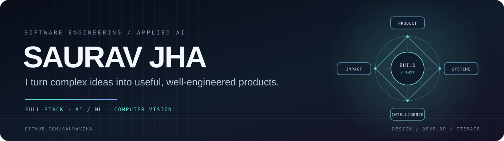
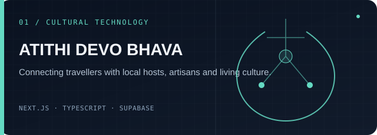
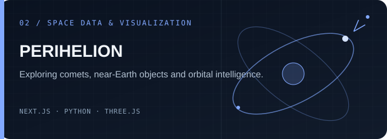
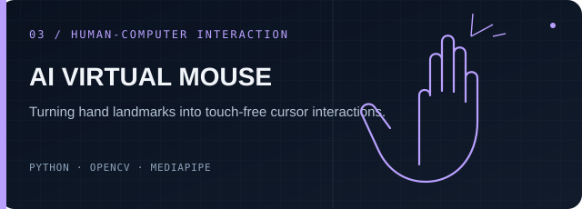
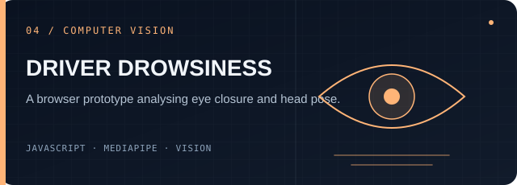
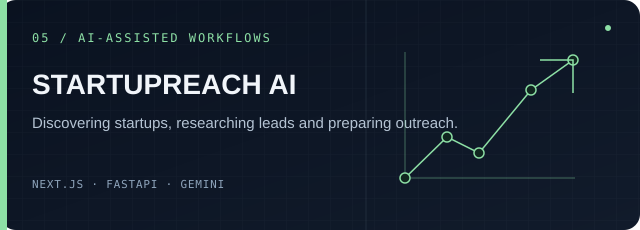
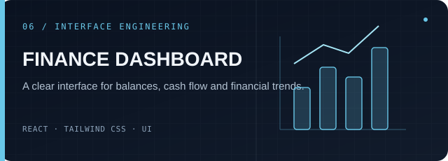

<div align="center">
  
  <br/>
  <a href="https://myportfolio-1-sigma.vercel.app/">PORTFOLIO</a>
  &nbsp; / &nbsp;
  <a href="https://www.linkedin.com/in/saurav-jha-555b8a211/">LINKEDIN</a>
  &nbsp; / &nbsp;
  <a href="https://github.com/sauravzha?tab=repositories">ALL REPOSITORIES</a>
</div>

<br/>

<table>
  <tr>
    <td width="62%" valign="top">
      <h2>01 / Profile</h2>
      <h3>Software developer building across product, systems and applied intelligence.</h3>
      I like turning messy problems into useful software — from the first interface sketch to backend logic, data workflows and deployment.
      <br/><br/>
      My interests sit at the intersection of <b>full-stack engineering, AI/ML, computer vision and product development</b>.
    </td>
    <td width="38%" valign="top">
      <h2>02 / Current focus</h2>
      <ul>
        <li>Building real-world web products</li>
        <li>Applying ML to practical workflows</li>
        <li>Designing clear, maintainable systems</li>
        <li>Learning through shipping and iteration</li>
      </ul>
    </td>
  </tr>
</table>

## 03 / Selected builds

<div align="center">
  <table>
    <tr>
      <td width="50%" valign="top"><a href="https://github.com/sauravzha/Atithidevobhava"></a></td>
      <td width="50%" valign="top"><a href="https://github.com/sauravzha/CelestialWatch"></a></td>
    </tr>
    <tr>
      <td width="50%" valign="top"><a href="https://github.com/sauravzha/AI-Virtual-Mouse"></a></td>
      <td width="50%" valign="top"><a href="https://github.com/sauravzha/drowsiness-detection-system"></a></td>
    </tr>
    <tr>
      <td width="50%" valign="top"><a href="https://github.com/sauravzha/Startupreach"></a></td>
      <td width="50%" valign="top"><a href="https://github.com/sauravzha/Finance-Dashboard-UI"></a></td>
    </tr>
  </table>
</div>

## 04 / Engineering toolkit

<table>
  <tr><td><b>LANGUAGES</b></td><td>Python · JavaScript · TypeScript · Java · C/C++ · SQL</td></tr>
  <tr><td><b>FRONTEND</b></td><td>React · Next.js · Vite · HTML · CSS · Tailwind CSS</td></tr>
  <tr><td><b>BACKEND</b></td><td>Django · Flask · FastAPI · REST APIs</td></tr>
  <tr><td><b>AI / VISION</b></td><td>TensorFlow · Keras · scikit-learn · OpenCV · MediaPipe</td></tr>
  <tr><td><b>DATA</b></td><td>Pandas · NumPy · MySQL · MongoDB · PostgreSQL</td></tr>
  <tr><td><b>TOOLS</b></td><td>Git · GitHub · Linux · Docker · Streamlit</td></tr>
</table>

## 05 / How I work

```text
UNDERSTAND  ->  DESIGN  ->  BUILD  ->  TEST  ->  SHIP  ->  ITERATE
     |            |         |        |       |          |
   Context      Clarity    Code   Evidence  Delivery  Learning
```

I value readable code, honest evaluation, useful documentation and engineering decisions that can be explained. I prefer a small feature that works well over a long list of claims that cannot be demonstrated.

## 06 / Connect

<div align="center">
  <a href="https://myportfolio-1-sigma.vercel.app/"><b>Explore my portfolio</b></a>
  &nbsp; · &nbsp;
  <a href="https://www.linkedin.com/in/saurav-jha-555b8a211/"><b>Connect on LinkedIn</b></a>

  <br/><br/>
  <sub>Independent builder · India · Always learning by making</sub>
</div>
